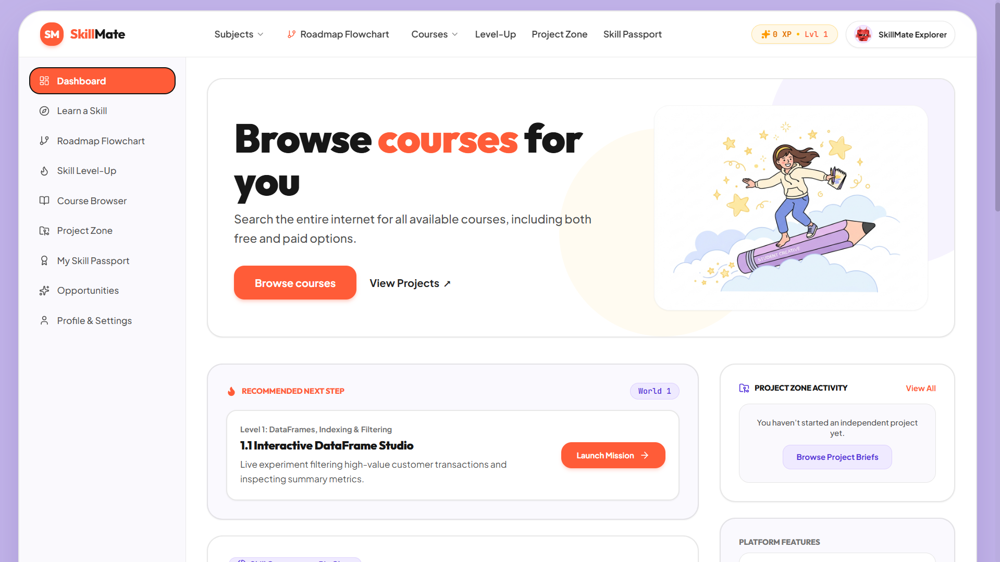

# SkillMate

SkillBridge is a personalized, gamified skill-development platform that transforms how students learn, practise, and demonstrate their abilities. It turns skill development into an interactive journey where students follow adaptive roadmaps, solve coding challenges, and build practical projects instead of simply consuming courses and collecting certificates.

It brings together four personalized learning pathways, a Candy Crush-inspired progression system, eight interactive challenge types, cross-platform course discovery, independent project building, and an automatically generated Skill Passport to connect learning with tangible outcomes. By adapting to what students already know and documenting what they accomplish, SkillBridge helps them turn learning progress into a portfolio of practical skills and real projects.

## Tech stack

- **Frontend:** React, TypeScript, Vite, Tailwind CSS, Lucide React
- **Backend:** Node.js, Express, TypeScript via `tsx`
- **Authentication and data:** Firebase Authentication and Cloud Firestore
- **AI features:** OpenAI API with Gemini fallback for learning-resource and roadmap generation
- **Local demo behaviour:** profiles and progress also use browser local storage in demo/guest flows

## Project layout

```text
SkillBridge/
├── backend/
│   └── server.ts                 # Express API and frontend-serving server
├── frontend/
│   ├── index.html                # Vite HTML entry point
│   ├── public/
│   │   └── images/               # Static images copied into the production build
│   └── src/
│       ├── components/           # Screens and reusable UI components
│       │   └── activities/       # The interactive practice activity components
│       ├── context/              # Authentication and learning-progress state
│       ├── data/                 # Curriculum, skill, course, project and opportunity data
│       ├── lib/                  # Firebase client setup and helpers
│       ├── types/                # Shared TypeScript types
│       ├── App.tsx               # Main application and navigation
│       ├── main.tsx              # Frontend entry point
│       └── index.css             # Global styles
├── firebase/
│   ├── firestore.rules           # Firestore access and validation rules
│   └── firebase-blueprint.json   # Data model/schema reference
├── scripts/
│   └── start-production.mjs      # Starts Express with production settings
├── docs/
│   ├── GITHUB-UPLOAD-GUIDE.md    # Beginner-friendly GitHub publishing steps
│   ├── MASTER-BUILD-PROMPT.md    # Original AI Studio build prompt
│   └── reference-images/         # Design screenshots; not used by the running app
├── .env.example                 # Safe configuration template (copy to .env)
├── package.json
├── tsconfig.json
└── vite.config.ts
```
Core Workflow

                         USER
                           |
                           v
              +--------------------------+
              |     User Profile &       |
              |     Learning Goal        |
              +--------------------------+
                           |
                           v
              +--------------------------+
              |       Select Skill       |
              |     (Web Development)    |
              +--------------------------+
                           |
                           v
              +--------------------------+
              |     Choose Roadmap       |
              | Normal / Advanced /      |
              | Smart / Quick Build      |
              +--------------------------+
                           |
                           v
              +--------------------------+
              |   Skill Assessment &     |
              |   Roadmap Generation     |
              +--------------------------+
                           |
                           v
              +--------------------------+
              |   Skill Level-Up Map     |
              | Worlds > Levels >        |
              | Sublevels                |
              +--------------------------+
                           |
                           v
              +--------------------------+
              |   Optional Learning     |
              |   Resources              |
              |   Videos / Courses /     |
              |   Reading Materials      |
              +--------------------------+
                           |
                           v
              +--------------------------+
              |    Interactive Learning  |
              |    & Challenge Engine    |
              +--------------------------+
                           |
                           v
              +--------------------------+
              |  1. Interactive Learning |
              |  2. Quizzes              |
              |  3. Missing Code         |
              |  4. Code Puzzles         |
              |  5. Bug Hunt             |
              |  6. Build from Scratch   |
              |  7. Predict Output       |
              |  8. Boss Missions        |
              +--------------------------+
                           |
                           v
              +--------------------------+
              |   Evaluate Required      |
              |   Activity Results       |
              +--------------------------+
                           |
                           v
                    +------------+
                    |  Passed?   |
                    +------------+
                     /          \
                    /            \
                  NO              YES
                  |                |
                  v                v
        +----------------+  +-------------------+
        | Feedback, Hints|  | Save Progress, XP |
        | & Retry        |  | & Achievements    |
        +----------------+  +-------------------+
                  |                |
                  +----->          v
                          +--------------------+
                          |  Unlock Next Level |
                          |  or Complete World |
                          +--------------------+
                                     |
                                     v
                          +--------------------+
                          | Update Skill       |
                          | Passport Records   |
                          +--------------------+


                   SEPARATE PROJECT ZONE
                   (Accessible at any time)

                     +----------------------+
                     | Separate Project Zone|
                     +----------------------+
                                |
                                v
                     +----------------------+
                     | Choose a Complete    |
                     | Project               |
                     +----------------------+
                                |
                                v
                     +----------------------+
                     | Build, Test &         |
                     | Complete Project     |
                     +----------------------+
                                |
                                v
                     +----------------------+
                     | Save Project         |
                     | & Evidence           |
                     +----------------------+
                                |
                                +-----------> Update Skill Passport


                   OPTIONAL LEARNING RESOURCES

                     +----------------------+
                     | YouTube Videos        |
                     | Courses & Articles    |
                     | Documentation         |
                     +----------------------+

                     Resources can be skipped.
                     They do not block missions
                     or level progression.

### Prototype

The SkillMate prototype presents the main dashboard and navigation for the platform, including the learning roadmap, course discovery, Skill Level-Up, Project Zone, and Skill Passport.

## Dashboard

The SkillBridge dashboard provides quick access to learning roadmaps, courses, projects, progress tracking, and the Skill Passport.




